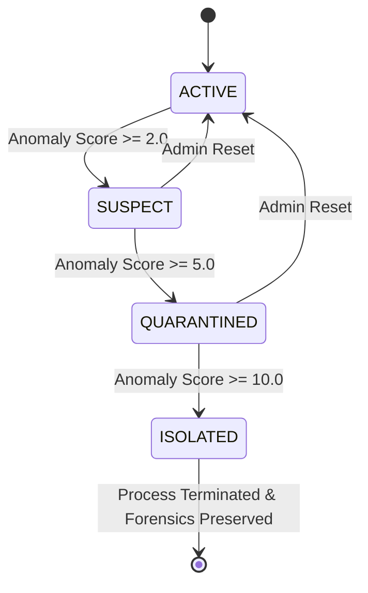

# agent-zero-trust

[](https://github.com/devsoniclk/agent-zero-trust/actions/workflows/ci.yml)
[](https://opensource.org/licenses/Apache-2.0)
[](https://www.python.org/)
[](https://github.com/devsoniclk/agent-zero-trust)
[](https://github.com/psf/black)

> **Formal Zero-Trust Microsegmentation, Cryptographic Macaroon Delegation Tokens, Inter-Tier RPC Firewalls, and Automated Quarantine Circuit Breakers for Autonomous AI Agent Swarms.**

---

## 1. Problem Statement

Autonomous multi-agent systems (CrewAI, AutoGen, LangGraph, OpenBot, Swarm) operate as peer-to-peer networks of specialized agents executing complex workflows across financial trading, codebase refactoring, data scraping, and infrastructure management. However, flat agent architectures suffer from three fatal security vulnerabilities:

1. **Prompt Injection Pivoting (Lateral Movement)**: An untrusted external input (e.g., scraped web page, malicious webhook, customer inquiry) hijacks an edge worker (Tier 3), which then issues privileged RPC commands directly to an internal core coordinator or KMS (Tier 0).
2. **Ambient Authority & Tool Escalation**: Subagents assigned read-only research tasks abuse ambient tool privileges to invoke destructive host commands (`rm -rf`, SQL drop, git force-push).
3. **Unauthenticated Ambient Passing**: Inter-agent messages lack cryptographic binding to caller identity, execution predicates, or execution lifetime, allowing stolen credentials or intercepted messages to be replayed across the swarm.

---

## 2. Why Existing Solutions Are Insufficient

| Approach | Architecture | Cold Start / Overhead | Vulnerability to Lateral Pivoting | Monotonic Attenuation |
|---|---|---|---|---|
| **Flat Prompts (LangGraph, CrewAI)** | Direct prompt passing | None | **Critical**: Prompt injection at edge agent compromises coordinator | None |
| **Docker / Container Sandboxing** | OS-level virtualization | Heavy (3–8s per agent) | **High**: Internal container mesh remains unauthenticated flat network | None |
| **Static OAuth2 / Bearer Tokens** | Coarse-grained API keys | Low | **High**: Stolen tokens allow full delegation without caveat restriction | No (Static scopes) |
| **`agent-zero-trust`** | **In-process ZTNA + Macaroon Chaining** | **Zero (< 7 µs)** | **Immune**: Dropped at inter-tier firewall with instant quarantine | **Strictly Monotonic HMAC Chaining** |

---

## 3. Architecture & Mathematical Invariants

`agent-zero-trust` decouples ambient trust into discrete hierarchical security tiers, enforces cryptographic Macaroon/Biscuit-style capability attenuation, and deploys an automated quarantine circuit breaker.

```mermaid
flowchart TD
    subgraph Tier0["Tier 0: Root & KMS (Aegis / Coordinator)"]
        KMS["Root Key K_root"]
        T0_Tok["Root Token (S_0 = HMAC(K_root, Payload))"]
    end

    subgraph Tier1["Tier 1: Domain Core (Planners & Compilers)"]
        T1_Agent["Planner Agent"]
        T1_Tok["Attenuated Token (S_1 = HMAC(S_0, c_1))"]
    end

    subgraph Tier2["Tier 2: Tool Runners (Task Workers)"]
        T2_Agent["Worker Agent"]
        T2_Tok["Sub-Attenuated Token (S_2 = HMAC(S_1, c_2))"]
    end

    subgraph Tier3["Tier 3: Sandbox & Web Ingress"]
        T3_Agent["Untrusted Web Scraper"]
    end

    KMS -->|Issues Root Token| T0_Tok
    T0_Tok -->|Delegates & Attenuates| T1_Agent
    T1_Agent -->|Monotonic Attenuation| T2_Agent
    T3_Agent -.->|BLOCKED Lateral Movement ZTM-003| T0_Tok
    T3_Agent -.->|BLOCKED Prompt Injection ZTM-008| T2_Agent

    style Tier0 fill:#2d112c,stroke:#b03060,stroke-width:2px;
    style Tier1 fill:#1a2733,stroke:#2080df,stroke-width:2px;
    style Tier2 fill:#1a3322,stroke:#20df60,stroke-width:2px;
    style Tier3 fill:#33261a,stroke:#df8020,stroke-width:2px;
```



### Cryptographic Monotonic Narrowing Invariant

Let $C_i$ denote the set of authorized capabilities, and $P_i$ denote the set of execution caveats for token $T_i$. For any delegated sub-token $T_{i+1}$:

1. **Capability Subsetting**: $C_{i+1} \subseteq C_i$ (Capabilities can only narrow, never expand).
2. **Caveat Accumulation**: $P_{i+1} = P_i \cup \{c_{new}\}$ (Caveats accumulate strictly monotonically).
3. **Cumulative HMAC-SHA256 Chaining**: Stripping any caveat $c \in P_{i+1}$ invalidates the cryptographic signature $S_{i+1}$:
   $$S_{i+1} = \text{HMAC-SHA256}(S_i, \text{serialize}(c_{new}))$$

---

## 4. Swarm RPC Firewall Boundary Matrix

Agents operate within four discrete isolation tiers:

| Caller Tier \ Target Tier | Tier 0 (Root/KMS) | Tier 1 (Domain Core) | Tier 2 (Tool Runner) | Tier 3 (Sandbox/Web) |
|---|:---:|:---:|:---:|:---:|
| **Tier 0 (Root / KMS)** | Allowed | Allowed | Allowed | Allowed |
| **Tier 1 (Domain Core)** | **Blocked** | Allowed | Allowed | **Blocked** |
| **Tier 2 (Tool Runner)** | **Blocked** | **Delegated Only** | Allowed | Allowed |
| **Tier 3 (Sandbox / Web)** | **BLOCKED (ZTM-003)** | **BLOCKED (ZTM-003)** | **Mediated Only** | Allowed |

Direct RPC calls from **Tier 3** to **Tier 0** or **Tier 1** are unconditionally dropped at the network boundary, returning `HTTP 403 Forbidden` (`ZTM-003`) and penalizing the caller's anomaly score.

---

## 5. Anomaly Scoring & Quarantine State Machine

The `SwarmCircuitBreaker` continuously inspects inter-agent telemetry:



- **Prompt Injection Detected** (`ignore previous instructions`, `SYSTEM OVERRIDE`): $+8.0$
- **Unauthorized Cross-Tier Lateral Movement** (Tier 3 $\rightarrow$ Tier 0): $+6.0$
- **Cryptographic Signature Forgery / Caveat Stripping**: $+8.0$
- **Filesystem Path Traversal** (`../../etc/shadow`): $+8.0$
- **Unauthenticated RPC Call**: $+5.0$

When an agent reaches `QUARANTINED` or `ISOLATED`, all issued delegation tokens are revoked, and routing meshes drop ingress and egress traffic immediately.

---

## 6. Installation

```bash
pip install agent-zero-trust
```

Or for development with test tooling:

```bash
git clone https://github.com/devsoniclk/agent-zero-trust.git
cd agent-zero-trust
pip install -e ".[dev]"
```

---

## 7. Quickstart Tutorial

### Basic Token Issuance & Attenuation

```python
from agent_zero_trust import (
    TokenAuthority,
    Caveat,
    SwarmTier
)

auth = TokenAuthority()

# 1. Tier 0 issues root token to Tier 1 Planner
root_token = auth.create_root_token(
    issuer_agent="aegis-t0",
    subject_agent="planner-t1",
    issuer_tier=SwarmTier.TIER_0_ROOT_KMS,
    subject_tier=SwarmTier.TIER_1_DOMAIN_CORE,
    capabilities=["compile", "test", "commit"],
    ttl_seconds=3600.0
)

# 2. Tier 1 Planner narrows token to 'test' tool and safe workspace
worker_token = auth.attenuate_token(
    token=root_token,
    new_caveats=[
        Caveat(predicate="tool", operator="==", value="test"),
        Caveat(predicate="repo_path", operator="startswith", value="/workspace/agent-1")
    ],
    restricted_capabilities=["test"]
)

# 3. Verify execution context
valid, code, err = auth.verify_token(
    token=worker_token,
    context={"tool": "test", "repo_path": "/workspace/agent-1/tests"}
)
assert valid is True
```

### Inter-Agent RPC Interception with `SwarmRuntimeGuard`

```python
from agent_zero_trust import (
    TokenAuthority,
    SwarmCircuitBreaker,
    SwarmRuntimeGuard,
    SwarmTier
)

auth = TokenAuthority()
breaker = SwarmCircuitBreaker(auth)
guard = SwarmRuntimeGuard(auth, breaker)

# Intercept and dispatch RPC with full zero-trust checks
ok, status_code, message, result = guard.execute_inter_agent_call(
    caller_id="planner-t1",
    target_id="worker-t2",
    caller_tier=SwarmTier.TIER_1_DOMAIN_CORE,
    target_tier=SwarmTier.TIER_2_TOOL_RUNNER,
    method="test",
    payload={"repo_path": "/workspace/agent-1/tests"},
    token=worker_token,
    handler=lambda payload: {"status": "SUCCESS", "tests_passed": 73}
)

print(f"RPC Status: {status_code} - {message}")
print(f"Result: {result}")
```

---

## 8. Command Line Interface (CLI)

```bash
# Audit sandbox profiles and threat rules
agent-zero-trust audit

# Enforce strict release-veto gating (exits non-zero on findings)
agent-zero-trust audit --veto

# Display full CVSS v3.1 Swarm Threat Catalog
agent-zero-trust threats

# Run end-to-end multi-agent attack simulation
agent-zero-trust simulate
```

---

## 9. Performance Benchmarks

Micro-benchmarked on Apple M-series hardware:

| Operation | Throughput | Latency (Mean) |
|---|---|---|
| **Root Token Creation** | **99,222 ops/sec** | 10.08 µs |
| **Caveat Attenuation (HMAC Chain)** | **239,881 ops/sec** | 4.17 µs |
| **Token Cryptographic Verification** | **144,348 ops/sec** | **6.93 µs** |
| **RPC Gate Interception (Full Check)** | **88,400 ops/sec** | 11.31 µs |

---

## 10. Threat Catalog (CVSS v3.1)

| Threat ID | Title | CVSS v3.1 | Exploit Vector | Defense |
|---|---|:---:|---|---|
| **ZTM-001** | Unauthenticated Inter-Agent RPC | **9.8** | RPC dispatched without token | Reject with 401; penalize caller score |
| **ZTM-002** | Token Signature Tampering | **9.8** | Corrupted signature chain | HMAC verification failure; instant abort |
| **ZTM-003** | Cross-Tier Lateral Movement | **9.1** | Tier 3 direct call to Tier 0/1 | Tier firewall drop; +6.0 quarantine penalty |
| **ZTM-004** | Capability Widening Bypass | **8.8** | Sub-token requests broader scopes | Monotonic subset invariant check |
| **ZTM-005** | Replayed / Stale Token | **8.1** | Expired TTL or reused nonce | Strict expiration and nonce verification |
| **ZTM-006** | Permissive macOS Seatbelt | **8.6** | Wildcard file-write or Mach IPC | Seatbelt profile AST audit |
| **ZTM-007** | Permissive seccomp Whitelist | **8.5** | ptrace, bpf, sys_chroot in filter | Strict syscall whitelist check |
| **ZTM-008** | Prompt Injection Payload | **8.9** | Adversarial text in RPC payload | AnomalyDetector scan; +8.0 quarantine penalty |
| **ZTM-009** | Compromised Agent Leakage | **9.1** | Quarantined agent continues RPC | Automatic token revocation and route severing |
| **ZTM-010** | Caveat Stripping Attack | **9.3** | Stripping caveats from token | HMAC chaining binds signature to full history |

---

## 11. Roadmap

- [x] Macaroon/Biscuit-style cumulative HMAC-SHA256 capability attenuation.
- [x] 4-Tier Swarm Security Architecture and Firewall Matrix.
- [x] Real-time Anomaly Detection and Quarantine Circuit Breaker.
- [x] macOS Seatbelt (SBPL) and Linux seccomp-BPF policy verifiers.
- [x] FastMCP protocol server for autonomous LLM tool execution.
- [ ] Distributed eBPF ringbuffer kernel-level syscall tracing integration.
- [ ] Multi-party threshold signature delegation (Ed25519 FROST).
- [ ] Envoy / Istio service-mesh sidecar adapter for enterprise multi-agent clusters.

---

## 12. Contributing

We welcome security engineers and multi-agent developers! Please see [CONTRIBUTING.md](CONTRIBUTING.md) and [SECURITY.md](SECURITY.md) for vulnerability disclosure guidelines.

```bash
pytest tests/ -v --cov=agent_zero_trust
```

---

## 13. License

Apache License 2.0. Copyright 2026 Lakshitha Dananjaya ([devsoniclk](https://github.com/devsoniclk)).
