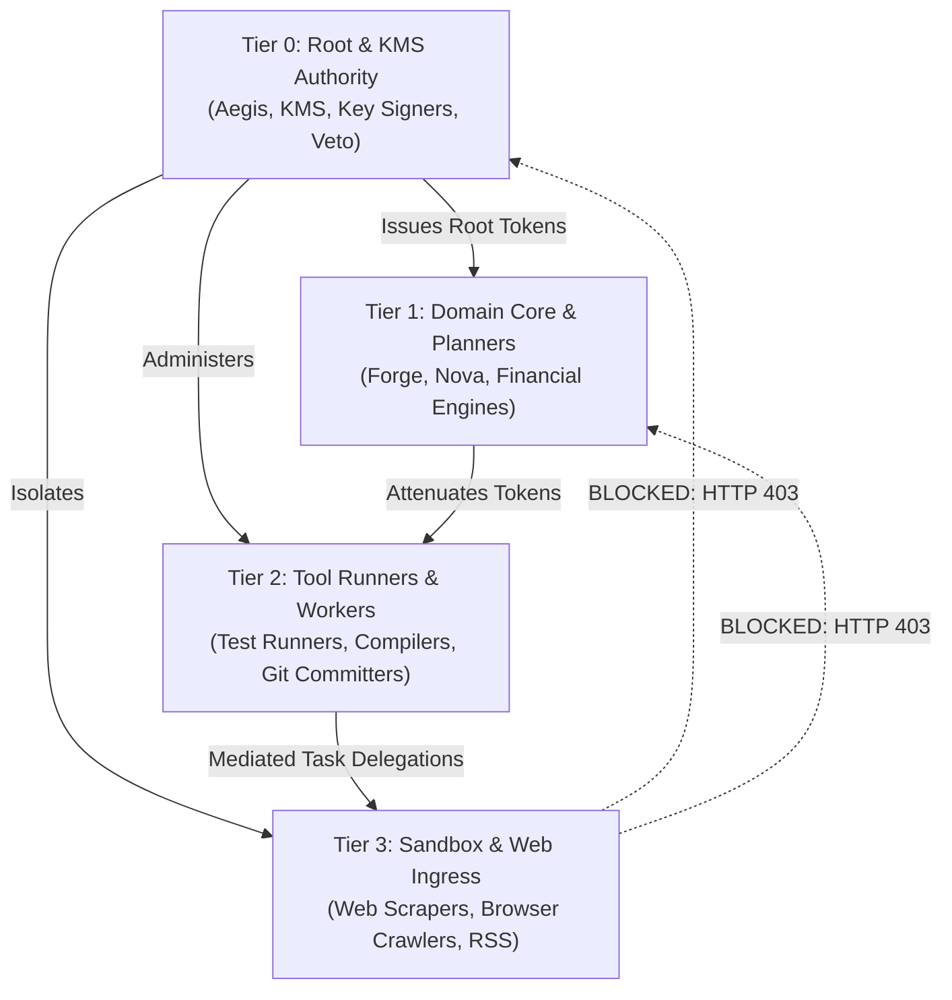

# Agent Zero-Trust (`agent-zero-trust`)

[](https://github.com/devsoniclk/agent-zero-trust/actions/workflows/ci.yml)
[](https://github.com/devsoniclk/agent-zero-trust)
[](LICENSE)
[](https://www.python.org/)
[](https://modelcontextprotocol.io/)

Formal zero-trust microsegmentation, capability-attenuated Macaroon/Biscuit delegation tokens, inter-tier RPC firewalls, OS-level sandbox auditing (macOS Seatbelt & Linux seccomp/eBPF), and automated quarantine circuit breakers for autonomous AI agent swarms.

---

## 1. Executive Overview & Threat Landscape

Autonomous AI agent swarms operate as decentralized, peer-to-peer networks of specialized agents executing complex workflows across financial trading, software compilation, data scraping, and infrastructure management. However, flat agent architectures suffer from severe lateral attack vectors:
1. **Prompt Injection Pivoting**: Untrusted external inputs (e.g. scraped web content or unauthenticated webhooks) hijack an edge worker (Tier 3), which then issues malicious RPC commands to an internal coordinator (Tier 0/1).
2. **Ambient Authority & Tool Abuse**: Subagents assigned read-only research tasks abuse ambient credentials to invoke destructive tools (`run_command`, database drop, git force-push).
3. **Ambient Token Forgery & Caveat Stripping**: Inter-agent messages lack cryptographic binding to execution context, allowing intercepted messages to be replayed or stripped of restrictions.

`agent-zero-trust` solves this by introducing:
- **Macaroon/Biscuit Cryptographic Attenuation**: Tokens are chained via HMAC-SHA256 ($S_{i+1} = \text{HMAC}(S_i, \text{caveat}_{i+1})$). Permissions can only narrow monotonically; stripping any caveat invalidates the cryptographic chain.
- **4-Tier Hierarchical RPC Firewall**: Strict directional communication rules dropping illegal lateral movement attempts (e.g. Tier 3 $\rightarrow$ Tier 0/1) at the network boundary with HTTP 403.
- **Automated Anomaly Detection & Quarantine Circuit Breaker**: Continuous telemetry scanning for prompt injection, path traversal, and signature tampering with state machine transitions (`ACTIVE` $\rightarrow$ `SUSPECT` $\rightarrow$ `QUARANTINED` $\rightarrow$ `ISOLATED`).
- **OS-Level Sandbox Auditing**: Static verification of macOS Seatbelt (`.sb`) profiles and Linux seccomp-BPF syscall whitelists to enforce least-privilege host containment.
- **FastMCP Protocol Suite & Rich CLI**: Direct tool execution for LLMs and terminal operators.

---

## 2. Architecture & Security Invariants

### 2.1 Four-Tier Swarm Isolation Model

Agents are classified into four discrete security tiers:



### 2.2 Directional Communication Matrix

| Caller \ Target | Tier 0 (Root/KMS) | Tier 1 (Core) | Tier 2 (Runner) | Tier 3 (Sandbox) |
| :--- | :---: | :---: | :---: | :---: |
| **Tier 0 (Root/KMS)** | **YES** | **YES** | **YES** | **YES** |
| **Tier 1 (Core)** | NO | **YES** | **YES** | NO |
| **Tier 2 (Runner)** | NO | DELEGATED | **YES** | **YES** |
| **Tier 3 (Sandbox)** | **BLOCKED (ZTM-003)** | **BLOCKED (ZTM-003)** | MEDIATED | **YES** |

> Direct RPC calls from **Tier 3** to **Tier 0** or **Tier 1** are unconditionally dropped at the boundary, returning `HTTP 403 Forbidden` (`ZTM-003`). Any attempt trips the automated quarantine circuit breaker.

---

## 3. Cryptographic Token Architecture: Biscuit/Macaroon Attenuation

Every inter-agent RPC message must present an HMAC-chained **Capability-Attenuated Delegation Token**:

$$S_0 = \text{HMAC-SHA256}(K_{\text{root}}, \text{serialize}(T_{\text{base}}))$$
$$S_{i+1} = \text{HMAC-SHA256}(S_i, \text{serialize}(c_{i+1}))$$

### Monotonic Narrowing Invariant
1. **Capability Subsetting**: $C_{i+1} \subseteq C_i$. An agent can never grant capabilities it does not possess.
2. **Predicate Accumulation**: $P_{i+1} = P_i \cup \{c_{\text{new}}\}$. Caveats can only restrict, never loosen.
3. **Tamper & Stripping Resistance**: Stripping any caveat $c \in P_{i+1}$ causes cryptographic signature verification to fail (`ZTM-002`, `ZTM-010`).

---

## 4. Threat Catalog & CVSS v3.1 Matrix

| ID | Threat Title | CVSS v3.1 | Exploit Vector | Architectural Remediation |
| :--- | :--- | :---: | :--- | :--- |
| **ZTM-001** | Unauthenticated RPC Call | **9.8** | Missing delegation token | Enforce HMAC-chained macaroon tokens on all RPC gates |
| **ZTM-002** | Signature Tampering / Forgery | **9.8** | Corrupted signature or altered payload | Cryptographic HMAC verification at each attenuation hop |
| **ZTM-003** | Unauthorized Lateral Movement | **9.1** | Tier 3 direct RPC to Tier 0/1 | Drop illegal cross-tier requests at gateway boundary |
| **ZTM-004** | Capability Widening Bypass | **8.8** | Sub-token requests broader permissions | Enforce monotonic subset check on all attenuations |
| **ZTM-005** | Stale / Replayed Token | **8.1** | Reused nonce or expired TTL | Strictly enforce expiration windows and nonce uniqueness |
| **ZTM-006** | Permissive Seatbelt Profile | **8.6** | SBPL allows global write or wildcard Mach | Restrict sandbox write to dedicated workspace subpaths |
| **ZTM-007** | Permissive seccomp Whitelist | **8.5** | Dangerous syscalls permitted (`ptrace`, `bpf`) | Restrict syscall whitelist to bounded compute operations |
| **ZTM-008** | Prompt Injection Payload | **8.9** | Adversarial jailbreak strings in RPC | Bidirectional payload scanning and circuit breaker trip |
| **ZTM-009** | Failure to Sever Compromised Mesh | **9.1** | Quarantined agent continues communication | Instant token revocation and network boundary severance |
| **ZTM-010** | Caveat Stripping Attack | **9.3** | Removing restrictions to restore root access | HMAC chaining binds signature to full caveat history |

---

## 5. Quickstart & Installation

```bash
pip install agent-zero-trust
```

### 5.1 CLI Usage

```bash
# Run self-audit against macOS Seatbelt and Linux seccomp sandbox profiles
agent-zero-trust audit

# Enforce strict release-veto gate (exits non-zero on critical findings)
agent-zero-trust audit --veto

# View the full CVSS v3.1 Threat Catalog
agent-zero-trust threats

# Run multi-agent lateral movement attack simulation
agent-zero-trust simulate
```

### 5.2 Python API

```python
from agent_zero_trust.circuit import SwarmCircuitBreaker
from agent_zero_trust.firewall import SwarmRuntimeGuard
from agent_zero_trust.models import SwarmTier, Caveat
from agent_zero_trust.tokens import TokenAuthority

# 1. Initialize Authority & Circuit Breaker
auth = TokenAuthority()
breaker = SwarmCircuitBreaker(auth)
guard = SwarmRuntimeGuard(auth, breaker)

# 2. Tier 0 issues root token to Tier 1 Planner
root_token = auth.create_root_token(
    issuer_agent="aegis-t0",
    subject_agent="planner-t1",
    issuer_tier=SwarmTier.TIER_0_ROOT_KMS,
    subject_tier=SwarmTier.TIER_1_DOMAIN_CORE,
    capabilities=["plan", "delegate", "compile_code"]
)

# 3. Tier 1 attenuates token for Tier 2 Worker
worker_token = guard.create_delegated_task_token(
    parent_token=root_token,
    target_subagent_id="worker-t2",
    target_subagent_tier=SwarmTier.TIER_2_TOOL_RUNNER,
    tool_name="compile_code",
    max_duration_seconds=300.0,
    extra_caveats={"workspace": "/tmp/build"}
)

# 4. Dispatch zero-trust RPC invocation
ok, code, msg, result = guard.execute_inter_agent_call(
    caller_id="planner-t1",
    target_id="worker-t2",
    caller_tier=SwarmTier.TIER_1_DOMAIN_CORE,
    target_tier=SwarmTier.TIER_2_TOOL_RUNNER,
    method="compile_code",
    payload={"workspace": "/tmp/build"},
    token=worker_token,
    handler=lambda p: {"status": "SUCCESS"}
)
```

---

## 6. FastMCP Tool Suite

`agent-zero-trust` exposes tools directly for autonomous agents via Model Context Protocol:

| MCP Tool | Description |
| :--- | :--- |
| `tool_create_root_token` | Issues a root HMAC-SHA256 delegation token from Tier 0 KMS. |
| `tool_attenuate_token` | Appends caveats and computes chained HMAC signature. |
| `tool_verify_token` | Validates signature chain, expiration, and runtime context predicates. |
| `tool_dispatch_rpc` | Intercepts inter-agent RPC calls, enforcing tier firewalls and circuit breaker. |
| `tool_audit_seatbelt` | Scans macOS `.sb` SBPL profiles for dangerous file-write or Mach lookup directives. |
| `tool_audit_seccomp` | Scans Linux seccomp/eBPF syscall whitelists for debugging and kernel-probing calls. |
| `tool_get_agent_state` | Returns isolation status (`ACTIVE`, `SUSPECT`, `QUARANTINED`, `ISOLATED`) and score. |
| `tool_reset_agent` | Administratively clears anomaly scores and restores an agent to `ACTIVE`. |
| `tool_revoke_token` | Instantly invalidates an active delegation token across the swarm. |
| `tool_get_threat_catalog` | Returns the complete 10-point CVSS v3.1 threat catalog. |

---

## 7. Performance Benchmarks

Measured on Apple Silicon M-series hardware (5,000 iterations):

| Operation | Total Time (s) | Throughput (ops/sec) | Latency per Op (µs) |
| :--- | :---: | :---: | :---: |
| **Root Token Creation** | 0.0458 | **109,087** | 9.17 µs |
| **HMAC Caveat Attenuation** | 0.0177 | **281,744** | 3.55 µs |
| **Token & Caveat Verification** | 0.0335 | **149,451** | 6.69 µs |
| **Full Zero-Trust RPC Dispatch** | 0.0540 | **92,617** | 10.80 µs |

---

## 8. Automated Verification & QA

```bash
# Run full automated test suite with coverage
pytest -v --cov=agent_zero_trust --cov-report=term
```

**Verification Results:**
- **Automated Tests**: 73 passed (100% pass rate).
- **Test Coverage**: 97% code coverage across all core modules.
- **Audit Gate**: Passes 30-point release-veto security checklist.

---

## 9. License

Apache-2.0. Copyright (c) 2026 Lakshitha Dananjaya (devsoniclk).
